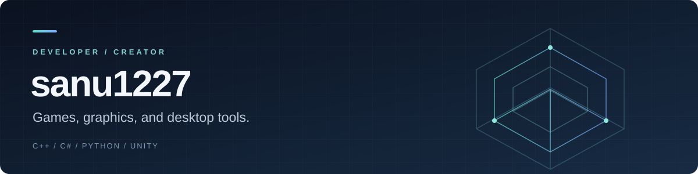

  

  <strong>Building interactive worlds. Making everyday tools.</strong> 
  게임을 만들고, 그래픽스를 탐구하고, 일상에 필요한 도구를 개발합니다.

  <a href="#selected-projects">Selected Projects</a> ·
  <a href="#engineering-foundations">Engineering Foundations</a> ·
  <a href="https://github.com/sanu1227?tab=repositories">All Repositories</a>

---

## Selected Projects

### [MoneyTown](https://github.com/sanu1227/MoneyTown)
**A market simulation built around information and judgment.**

뉴스 속 단서를 해석하고 가상 기업에 투자하는 싱글 플레이 게임입니다. 정보의 신뢰도와 가격을 판단하는 플레이에 거래, 자산 관리, 성장 이야기를 더했습니다.

`Unity` · `C#` · `uGUI` · `Game Systems`

[Explore the project](https://github.com/sanu1227/MoneyTown) · [Screenshots](https://github.com/sanu1227/MoneyTown/blob/main/docs/gallery.md) · [Architecture](https://github.com/sanu1227/MoneyTown/blob/main/docs/architecture.md)

### [RefArchive](https://github.com/sanu1227/RefArchive-releases)
**A personal reference library for Windows.**

이미지, 영상, 문서, 텍스트와 링크를 한곳에 보관하고 키워드와 카테고리로 찾는 데스크톱 도구입니다. 공개 저장소에서 설치 파일과 업데이트 안내를 제공합니다.

`Windows` · `Reference Management` · `Desktop Tools`

[Download & release notes](https://github.com/sanu1227/RefArchive-releases/releases/latest) · [Getting started](https://github.com/sanu1227/RefArchive-releases#readme)

## Engineering Foundations

프로젝트를 뒷받침하는 기초를 코드로 쌓고 있습니다.

| Area | Repository | Focus |
| :--- | :--- | :--- |
| Computer Graphics | [Computer-Graphics](https://github.com/sanu1227/Computer-Graphics) | C++ 그래픽스 실습과 렌더링 기초 |
| Windows Programming | [WinAPI](https://github.com/sanu1227/WinAPI) | Win32 데스크톱 프로그래밍과 인터랙션 |
| Data Structures | [Data-Structure](https://github.com/sanu1227/Data-Structure) | C++ 자료구조 구현과 응용 |
| 2D Game Programming | [2026-2DGP](https://github.com/sanu1227/2026-2DGP) | Python 기반 게임 프로그래밍 수업과 실습 |

Course repositories include classroom exercises and upstream teaching materials.

## Working With

**Languages** &nbsp; C++ · C# · Python 
**Game & Desktop** &nbsp; Unity · Win32 
**Tools** &nbsp; Visual Studio · Git · GitHub

---

Games · Graphics · Practical Software

